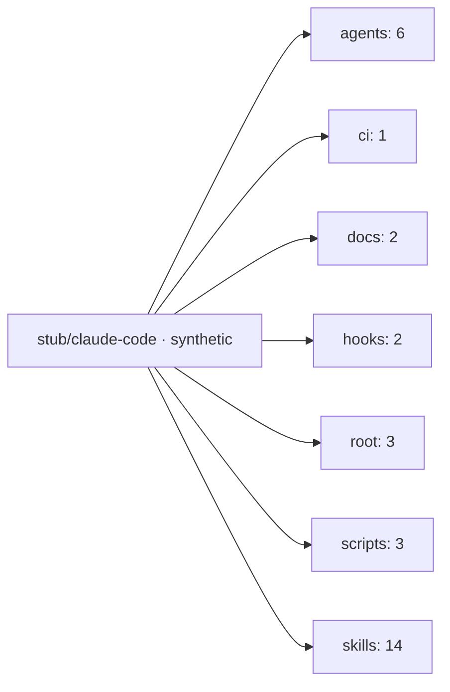

# Repository map: stub/claude-code · synthetic

Structure and git-history counts of stub/claude-code · synthetic at commit `c91e2ba`, committed 2026-03-26 (ISO week 2026-W13).
File contents are not published; every figure below is a count or a name.

## At a glance

| Measure | Value |
|---|---|
| Skills | 8 |
| Agent types | 6 |
| Scripts | 6 |
| Sections | 1 |
| Hooks | 2 |
| Docs | 2 |
| Tracked files | 31 |
| Commits | 8 |
| Merges | 1 |
| Weeks | 4 |

## Areas

Tracked files per area at the exported commit.

## Activity

Commits per ISO week, from 2026-W10 to 2026-W13.

Share of changed files per area and week.

Changed files per area and week.

## Skills

| Skill | Scripts | Sections | SKILL.md bytes | Summary |
|---|---|---|---|---|
| skill-alpha | 1 | 0 | 147 | no summary |
| skill-bravo | 0 | 0 | 197 | no summary |
| skill-charlie | 0 | 0 | 176 | no summary |
| skill-delta | 0 | 0 | 161 | no summary |
| skill-echo | 1 | 0 | 147 | no summary |
| skill-foxtrot | 1 | 1 | 133 | no summary |
| skill-golf | 0 | 0 | 158 | no summary |
| skill-hotel | 0 | 0 | 158 | no summary |

## Agent types

| Agent type | Model | Effort | Preloads | Summary |
|---|---|---|---|---|
| checker | opus | high | 1 | no summary |
| checker-bulk | sonnet | medium | 1 | no summary |
| checker-lite | haiku | low | 1 | no summary |
| worker | opus | medium | 1 | no summary |
| worker-bulk | sonnet | low | 1 | no summary |
| worker-lite | haiku | low | 1 | no summary |

## Summaries

Owner-approved summary lines, one per line.

No summary rows.

## Data

- [data/atlas.json](data/atlas.json): structure at the exported commit
- [data/history.json](data/history.json): counts per ISO week
- [data/SHA256SUMS](data/SHA256SUMS): checksums of every other file

## License

AGPL-3.0, see [LICENSE](LICENSE).
